# 맛집 관리 REST API

- **Render Deployment URL:** https://week09-webd.onrender.com/api/restaurants
- **GitHub Organization Repository:** https://github.com/2026-2-WebService/assign09-c01-22300133
- **Personal GitHub Repository:** https://github.com/shkim2104/week09_webD

---

## ① 프로젝트 소개

### 주제 및 주요 기능

가 본 맛집의 정보를 저장하고 관리하는 REST API입니다. Spring Data JPA와 MariaDB를 사용해서 데이터가 실제 DB에 저장됩니다.

- 맛집 등록, 전체 조회, 단건 조회, 수정, 삭제
- 필수값이 없거나 평점이 음수인 요청은 `400 Bad Request`로 거부
- 존재하지 않는 ID를 요청하면 `404 Not Found` 응답

### Entity 필드 구조

| 필드 | Java 타입 | 설명 | 제약 |
|---|---|---|---|
| `id` | `long` | 기본키 | 자동 증가 |
| `name` | `String` | 가게 이름 | 필수, 최대 200자 |
| `category` | `String` | 카테고리 | 필수, 요청 최대 100자 |
| `address` | `String` | 주소 | 필수, 요청 최대 50자 |
| `rating` | `double` | 평점 | 필수, 0 이상 |
| `signatureMenu` | `String` | 대표 메뉴 | 필수, 요청 최대 50자 |

### 프로젝트 구조

요청은 `Controller → Service → JpaRepository → Hibernate → MariaDB` 순서로 처리됩니다.

```text
src/main/java/org/example/jpaassign/week09_jpa_project/
├── Week09JpaProjectApplication.java
├── controller/RestaurantController.java
├── service/RestaurantService.java
├── repository/RestaurantRepository.java
├── entity/Restaurant.java
└── dto/
    ├── RestaurantRequest.java
    └── RestaurantResponse.java
```
---

## ② Database SQL Practice

### 기존 Table 조회 및 데이터 추가

TODO: 지난 수업 Table의 SELECT, INSERT, 추가 후 SELECT 결과 캡처를 넣고 SQL을 작성

### 새 Table 생성

```sql
CREATE TABLE movie_sql (
    id BIGINT AUTO_INCREMENT PRIMARY KEY,
    title VARCHAR(100) NOT NULL,
    director VARCHAR(100),
    genre VARCHAR(50),
    rating DOUBLE
);
```

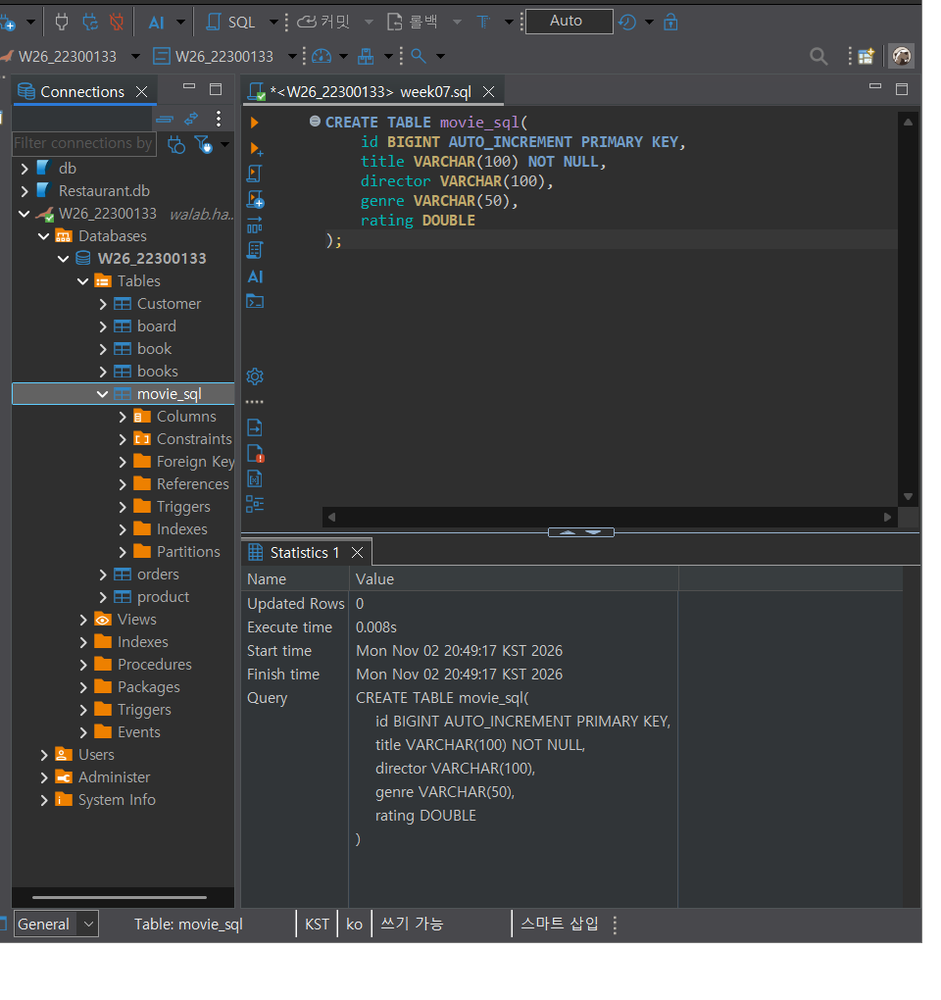

### INSERT

```sql
INSERT INTO movie_sql(title, director, genre, rating)
VALUES ('Inception', 'Nolan', 'SF', 9.1),
       ('Interstellar', 'Nolan', 'SF', 9.3),
       ('Parasite', 'Bong', 'Drama', 9.0);
```

실행 후 3개의 행이 추가된 것을 확인했습니다.

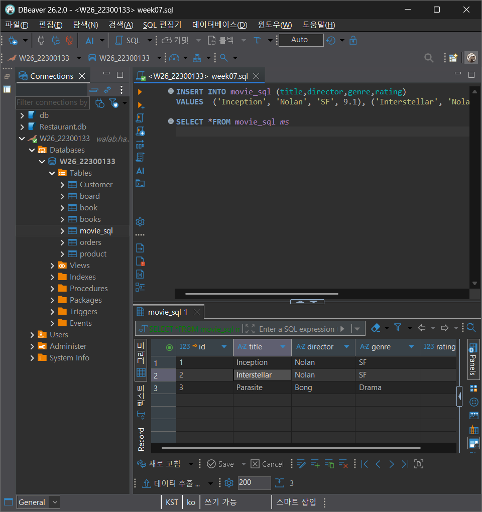

### UPDATE

```sql
UPDATE movie_sql SET rating = 9.5 WHERE title = 'Interstellar';
```

Interstellar의 평점이 9.5로 바뀌었습니다.

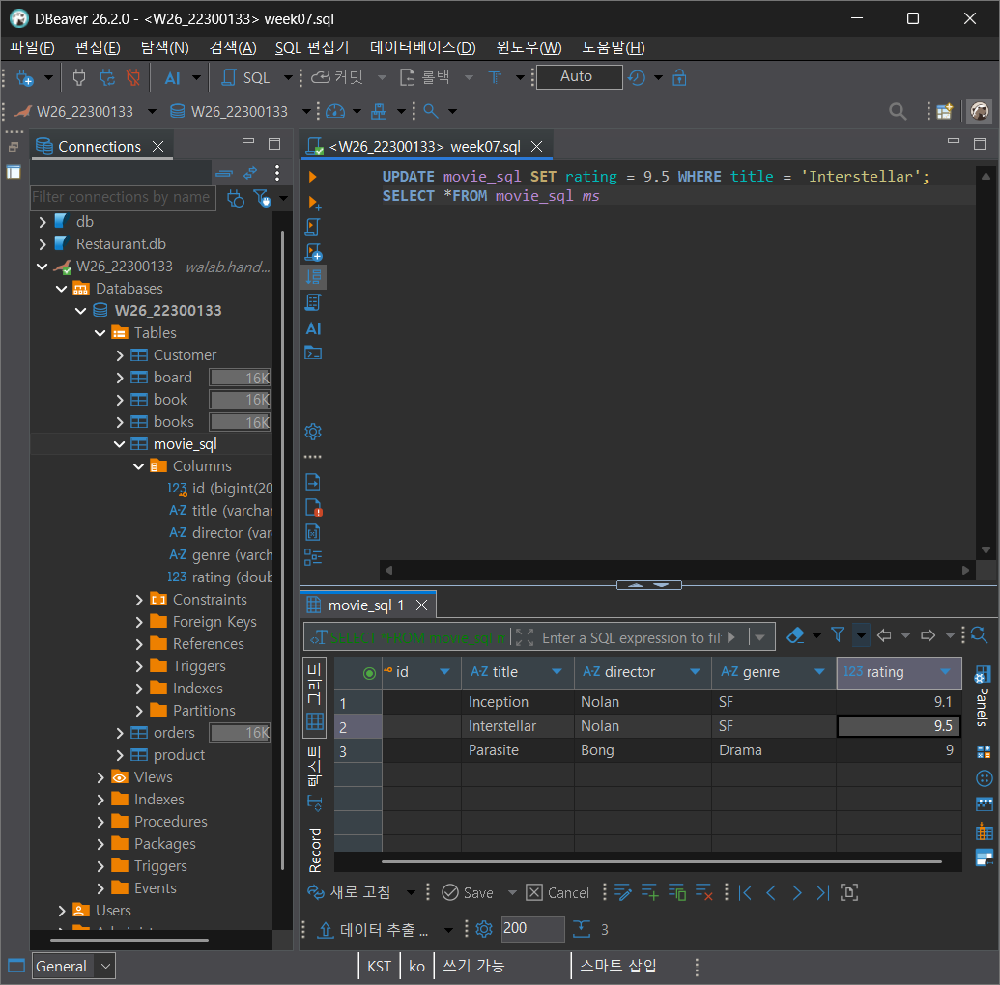

### DELETE

```sql
DELETE FROM movie_sql WHERE title = 'Parasite';
```

Parasite가 삭제되어 Inception, Interstellar 2개의 행만 남았습니다.

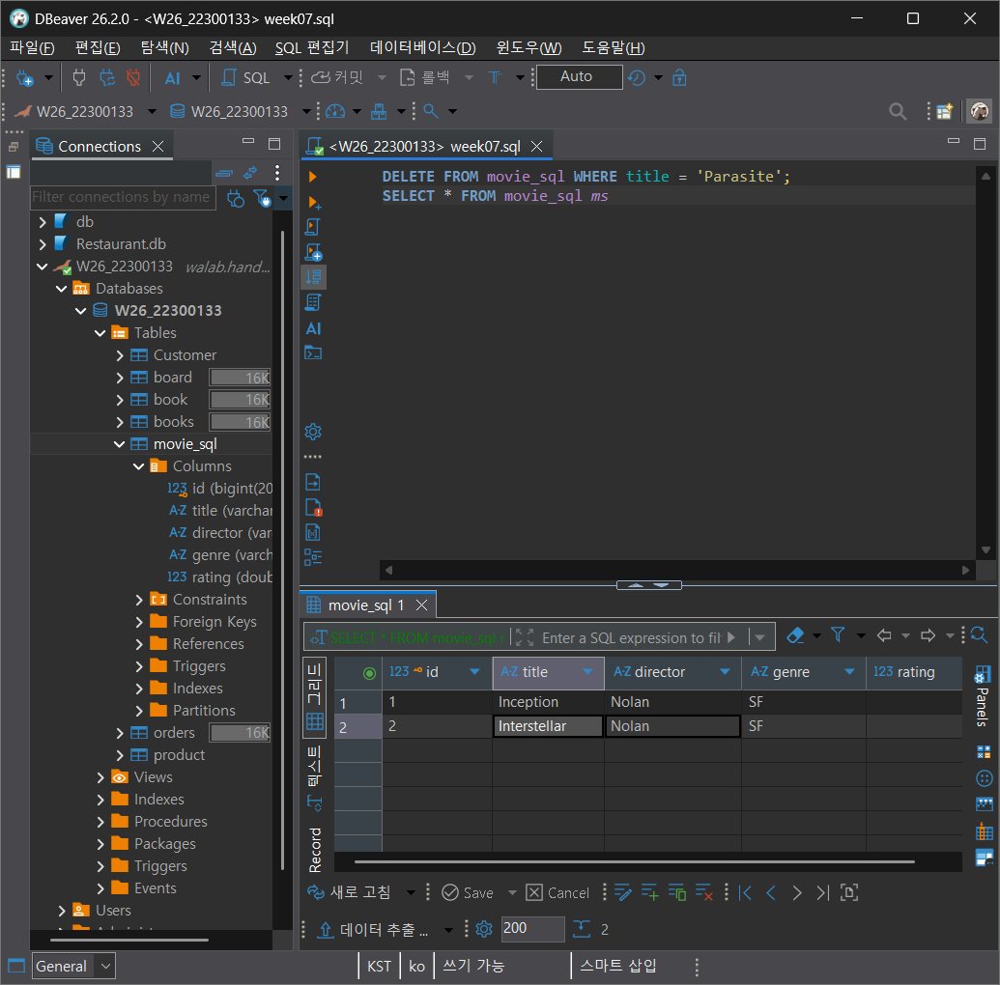

### SELECT

전체 조회 결과는 위 DELETE 캡처에서 확인할 수 있습니다.

```sql
SELECT * FROM movie_sql;
```

필요한 컬럼만 조회하면 title과 rating 2개의 컬럼만 나옵니다.

```sql
SELECT title, rating FROM movie_sql;
```

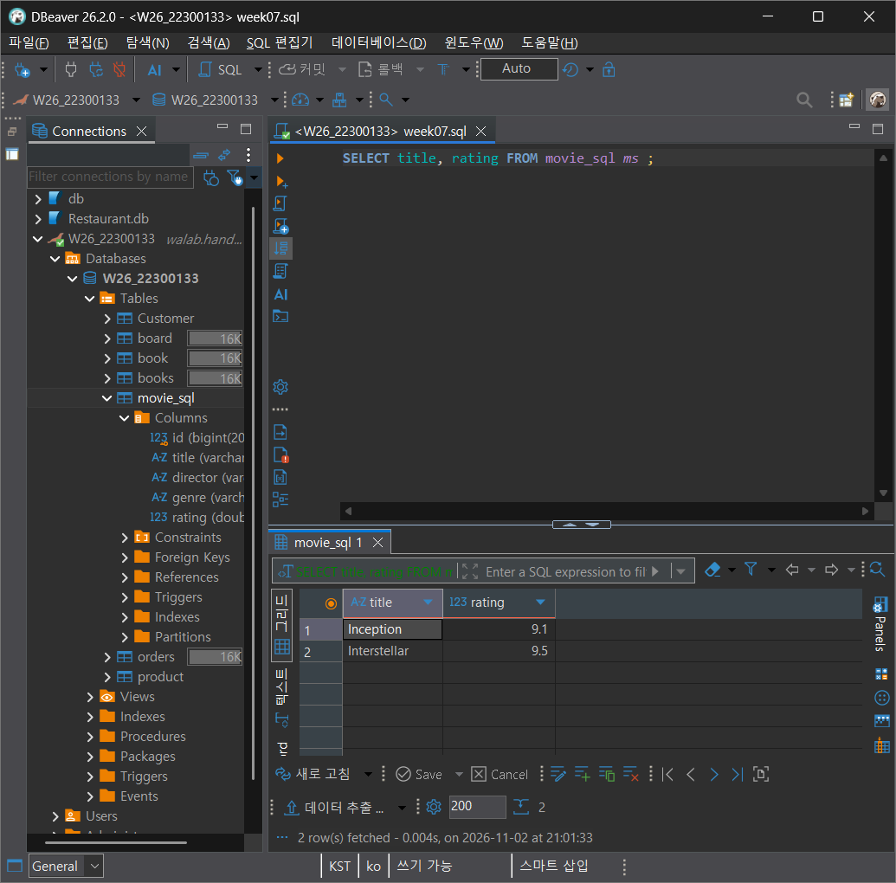

조건으로 조회하면 genre가 SF인 2개의 행이 나옵니다.

```sql
SELECT * FROM movie_sql WHERE genre = 'SF';
```

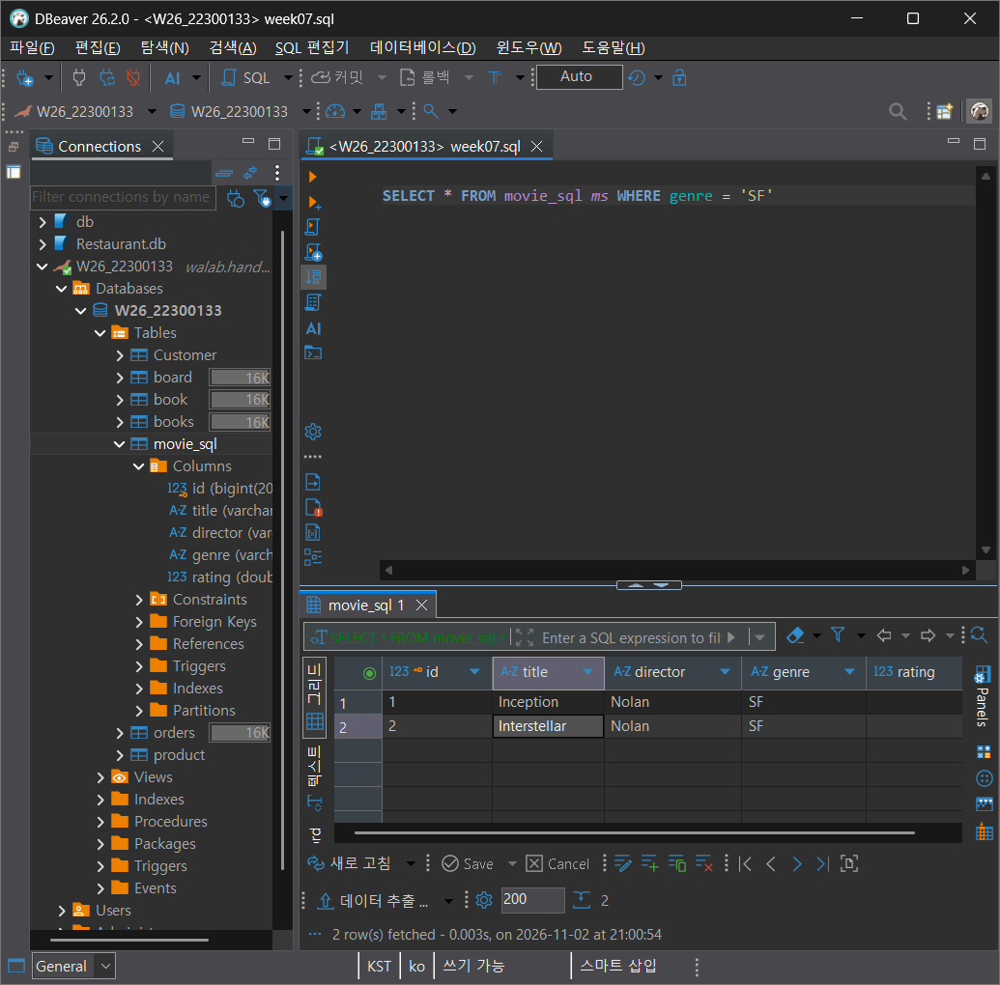

---

## ③ Spring Data JPA 구현

### Entity와 JpaRepository

`Restaurant`는 `restaurants` Table과 연결되는 Entity입니다. 요청 DTO를 받는 생성자로 새 데이터를 만들고, `update()` 메서드로 값을 수정합니다. JPA가 조회 결과로 객체를 만들 수 있도록 `protected` 기본 생성자도 두었습니다.

```java
public interface RestaurantRepository extends JpaRepository<Restaurant, Long> {
}
```

`JpaRepository<Restaurant, Long>`을 상속하는 것만으로 `save()`, `findAll()`, `findById()`, `existsById()`, `deleteById()`를 쓸 수 있습니다. 구현 클래스는 직접 만들지 않아도 Spring Data JPA가 만들어 줍니다.

### 사용한 Annotation

| Annotation | 역할 |
|---|---|
| `@Entity` | 클래스를 JPA가 관리하는 Entity로 지정 |
| `@Table(name = "restaurants")` | 연결할 Table 이름 지정 |
| `@Id` | 기본키 필드 지정 |
| `@GeneratedValue(strategy = GenerationType.IDENTITY)` | DB의 AUTO_INCREMENT로 id 생성 |
| `@Column` | 컬럼의 `nullable`, `length` 등 지정 |
| `@RestController`, `@RequestMapping` | REST API 클래스와 기본 경로 지정 |
| `@Service` | 비즈니스 로직 클래스를 Bean으로 등록 |
| `@Valid`, `@NotBlank`, `@NotNull`, `@PositiveOrZero`, `@Size` | 요청 값 검증 |

### REST API Endpoint

| Method | URL | 기능 | 성공 | 실패 |
|---|---|---|---|---|
| POST | `/api/restaurants` | 등록 | `201 Created` | `400` |
| GET | `/api/restaurants` | 전체 조회 | `200 OK` | |
| GET | `/api/restaurants/{id}` | 단건 조회 | `200 OK` | `404` |
| PUT | `/api/restaurants/{id}` | 수정 | `200 OK` | `400`, `404` |
| DELETE | `/api/restaurants/{id}` | 삭제 | `204 No Content` | `404` |

**POST 요청**

```json
{
  "name": "김천",
  "category": "분식",
  "address": "경기 양주",
  "rating": 4.5,
  "signatureMenu": "김밥"
}
```

**POST 응답 (`201 Created`)**

```json
{
  "id": 1,
  "name": "김천",
  "category": "분식",
  "address": "경기 양주",
  "rating": 4.5,
  "signatureMenu": "김밥"
}
```

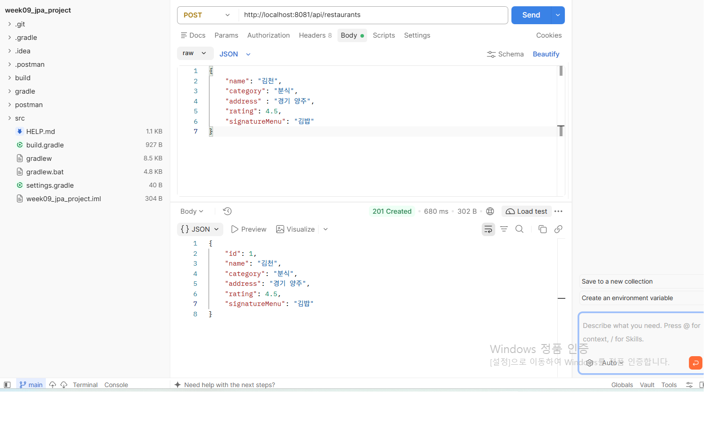

**PUT `/api/restaurants/1` 요청**

```json
{
  "name": "환여횟집",
  "category": "한식",
  "address": "포항 북구 영일대",
  "rating": 3,
  "signatureMenu": "물회"
}
```

**PUT 응답 (`200 OK`)**

```json
{
  "id": 1,
  "name": "환여횟집",
  "category": "한식",
  "address": "포항 북구 영일대",
  "rating": 3.0,
  "signatureMenu": "물회"
}
```

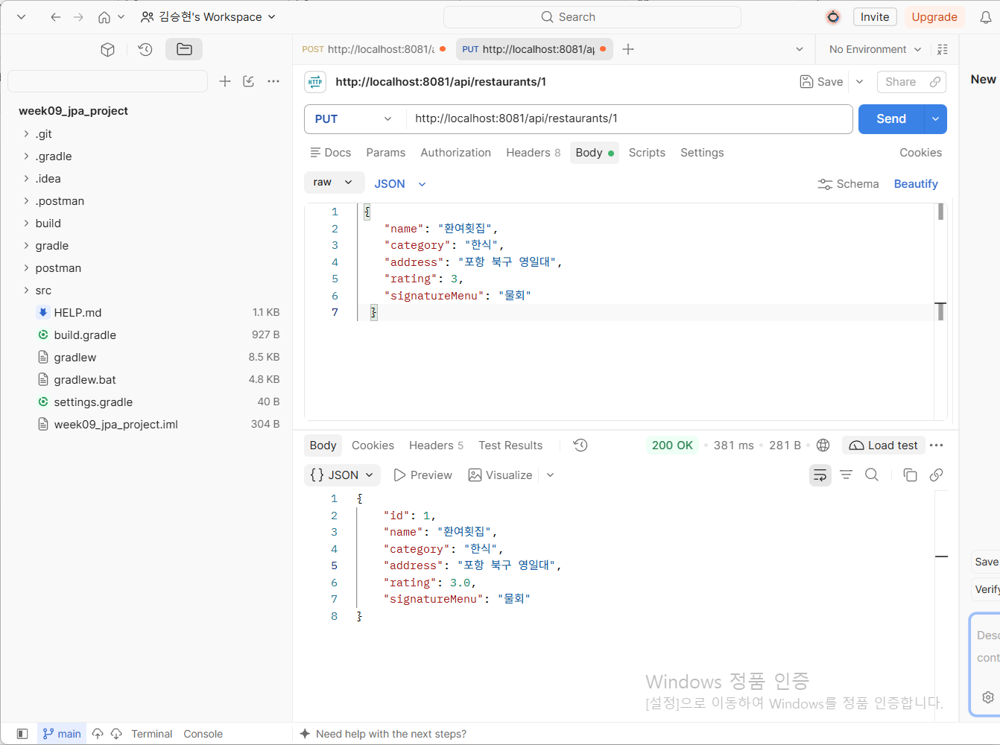

**GET `/api/restaurants` 응답**

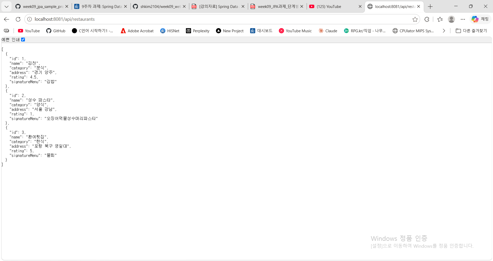

**없는 ID 조회 (`404 Not Found`)**

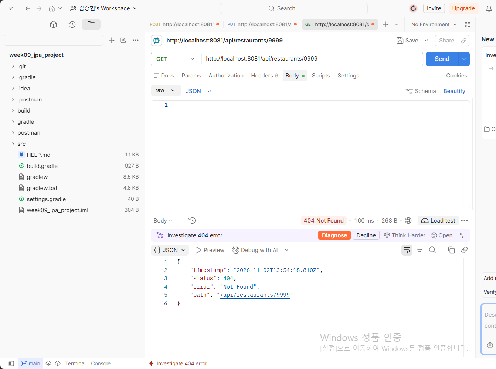

**없는 ID 삭제 (`404 Not Found`)**

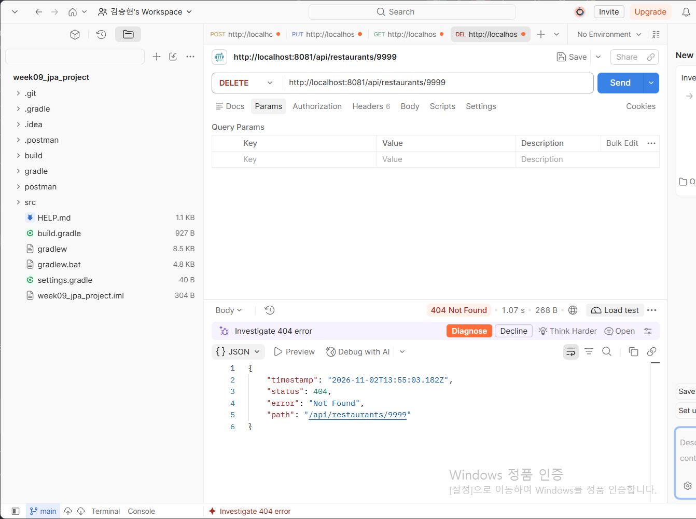

**`name`이 빈 값인 등록 요청 (`400 Bad Request`)**

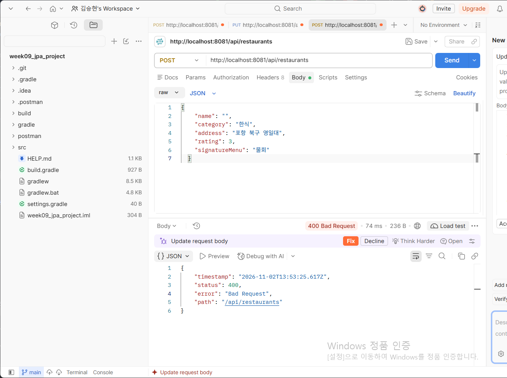

TODO: 단건 조회 성공(`200`)과 삭제 성공(`204`) 캡처 추가

### JPA Entity와 MariaDB Table 비교

SQL 실습 Table은 `movie_sql`, JPA Table은 `restaurants`로 이름을 다르게 했습니다. Table은 앱을 처음 실행할 때 `ddl-auto=update` 설정으로 Hibernate가 자동으로 만들었습니다.

```sql
create table restaurants (
    id bigint not null auto_increment,
    address varchar(200) not null,
    category varchar(200) not null,
    name varchar(200) not null,
    rating float(53) not null,
    signature_menu varchar(200) not null,
    primary key (id)
) engine=InnoDB
```

| Entity 필드 | Java 타입 | Table 컬럼 | DB 타입 |
|---|---|---|---|
| `id` | `long` | `id` | `bigint`, `auto_increment` |
| `name` | `String` | `name` | `varchar(200)` |
| `category` | `String` | `category` | `varchar(200)` |
| `address` | `String` | `address` | `varchar(200)` |
| `rating` | `double` | `rating` | `float(53)` |
| `signatureMenu` | `String` | `signature_menu` | `varchar(200)` |

camelCase 필드 이름인 `signatureMenu`가 snake_case 컬럼 이름인 `signature_menu`로 바뀌어 저장됩니다.

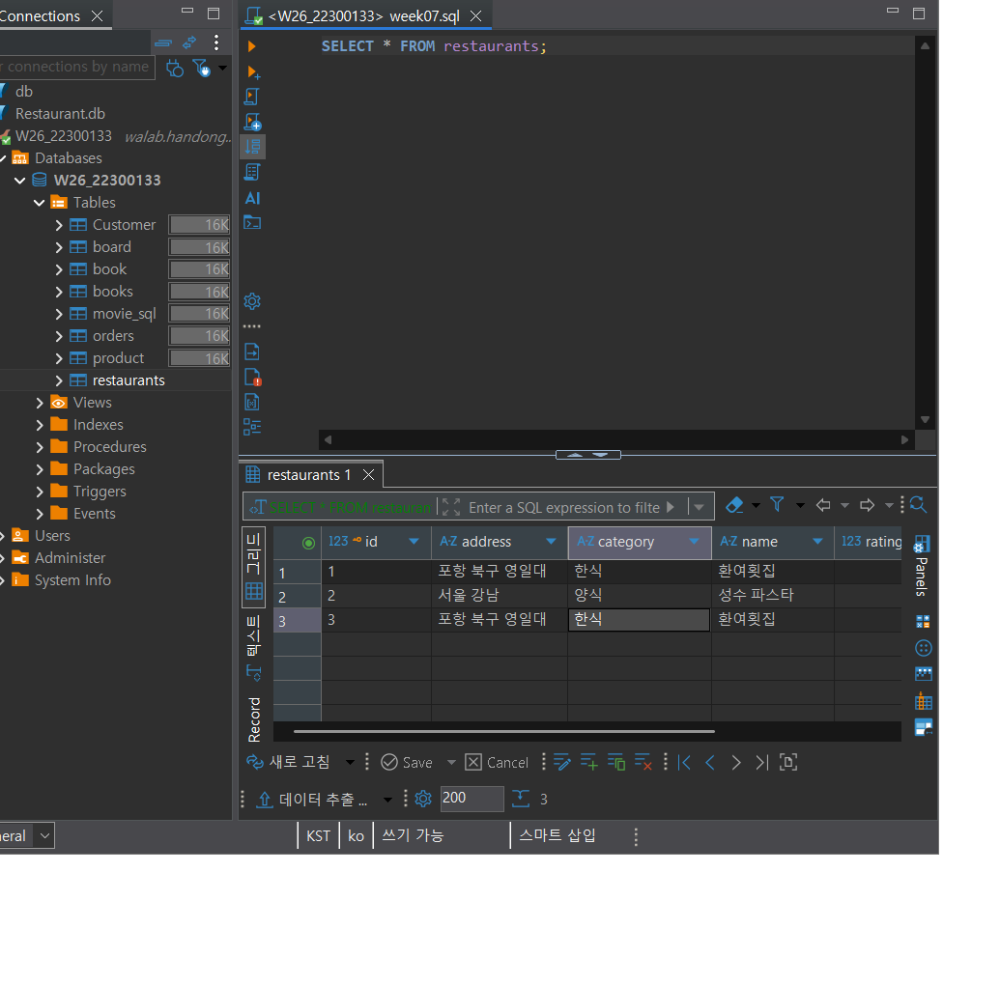

---

## ④ JPA와 SQL 비교

### 메서드 사용 결과

| 사용한 곳 | 메서드 | 결과 | SQL 종류 |
|---|---|---|---|
| 등록 | `save()` | 새 데이터 저장, id 생성 | `INSERT` |
| 전체 조회 | `findAll()` | 전체 목록 반환 | `SELECT` |
| 단건 조회 | `findById()` | `Optional` 반환, 없으면 404 처리 | `SELECT ... WHERE` |
| 수정 | `findById()`, `save()` | 조회 후 값을 바꿔 저장 | `SELECT`, `UPDATE` |
| 삭제 | `existsById()`, `deleteById()` | ID 확인 후 삭제 | `SELECT`, `DELETE` |

### 실제 Hibernate SQL

전체 조회를 했을 때 콘솔에 출력된 SQL입니다.

```sql
select
    r1_0.id,
    r1_0.address,
    r1_0.category,
    r1_0.name,
    r1_0.rating,
    r1_0.signature_menu
from
    restaurants r1_0
```

TODO: IntelliJ 콘솔에서 POST의 insert, PUT의 update, DELETE의 delete SQL을 복사해서 추가

### SQL을 직접 작성하는 방식과 JPA 방식의 차이

| 구분 | SQL 직접 작성 | JPA |
|---|---|---|
| 작성 방식 | `INSERT`, `UPDATE` 등을 직접 작성 | Repository 메서드를 호출하면 Hibernate가 SQL 생성 |
| Table 생성 | `CREATE TABLE` 실행 | Entity 기준으로 자동 생성 (`ddl-auto=update`) |
| 다루는 대상 | Table과 행 | Java 객체 |
| 장점 | 실행되는 쿼리를 정확히 제어 | 반복되는 CRUD 코드가 줄어듦 |
| 주의할 점 | 컬럼이 바뀌면 SQL도 수정 | 실제 실행되는 SQL을 로그로 확인해야 함 |

`movie_sql`에서는 SQL을 직접 썼지만, `restaurants`에서는 SQL을 한 줄도 쓰지 않고 같은 CRUD를 구현했습니다.

---

## ⑤ 배포 및 환경 설정

### 환경변수

DB 정보는 코드에 쓰지 않고 환경변수로 받습니다.

| 변수 이름 | 내용 |
|---|---|
| `DB_URL` | JDBC 접속 주소 |
| `DB_USERNAME` | DB 계정 |
| `DB_PASSWORD` | DB 비밀번호 |

- **IntelliJ:** Run → Edit Configurations → Environment variables에 3개를 등록했습니다.
- **Render:** 서비스의 Environment 메뉴에 같은 3개를 등록했습니다.

`server.port=${PORT:8081}`로 설정해서 `PORT` 환경변수가 있으면 그 값을 쓰고, 로컬에서는 8081을 씁니다.

### Render 배포 과정

1. `Dockerfile`을 작성합니다. JDK 17 이미지에서 `bootJar`로 빌드하고, JRE 17 이미지에서 jar를 실행합니다.
2. GitHub에 Push합니다.
3. Render에서 Web Service를 만들고 Docker 방식으로 저장소를 연결합니다.
4. 환경변수 3개를 등록하고 배포합니다.
5. 로그에서 `Started Week09JpaProjectApplication`을 확인합니다.

### 배포 URL의 CRUD 테스트 결과

TODO: 배포 URL로 POST, GET, PUT, DELETE를 실행한 캡처 추가

### MariaDB 데이터 저장 확인

TODO: Render에서 등록한 데이터를 DBeaver에서 조회한 캡처 추가

### 발생한 문제와 해결 방법

| 문제 | 원인 | 해결 |
|---|---|---|
| `Port 8080 was already in use` | 이전에 실행한 같은 앱이 8080을 사용 중 | 기본 포트를 8081로 변경 |
| `Cannot resolve symbol 'validation'` | `build.gradle`에 validation 의존성이 없음 | `spring-boot-starter-validation` 추가 후 Gradle 새로고침 |
| POST가 `400 Bad Request` | 요청 Body의 `address`가 서버에 전달되지 않아 `rejected value [null]` 발생 | 콘솔 WARN 로그로 필드를 찾아 Body 수정 |
| `HHH000511` 경고 | DB가 MariaDB 10.1.48로 Hibernate 지원 버전(10.6 이상)보다 낮음 | 경고는 남지만 앱 실행과 로컬 CRUD는 정상 동작 확인 |

TODO: 배포 중 발생한 문제가 있으면 추가

---

## ⑥ Weekly Report

### Key Learning

1. **Repository 인터페이스:** `JpaRepository`를 상속하기만 해도 기본 CRUD를 쓸 수 있고, Hibernate가 SQL을 만들어 실행한다는 것을 콘솔 로그로 확인했습니다.
2. **환경변수:** `${DB_URL}`처럼 설정 파일에는 이름만 두고 값은 실행 환경에서 넣으면, 계정 정보를 GitHub에 올리지 않고도 로컬과 Render에서 같은 코드를 쓸 수 있습니다.
3. **`@Valid`와 400 응답:** 잘못된 요청은 Service까지 가지 않고 Controller 단계에서 거부됩니다. 응답에 이유가 나오지 않아도 콘솔의 `rejected value`로 원인을 찾을 수 있습니다.

### Problem & Solution

POST 요청이 계속 `400 Bad Request`로 실패했는데, 응답에는 이유가 나오지 않았습니다. IntelliJ 콘솔의 WARN 로그를 보니 `address` 필드에서 `rejected value [null]`이 나와 있었습니다. 처음에는 `signatureMenu`와 `address` 2개가 문제였고, 요청 Body를 고치면서 하나씩 해결했습니다. 코드가 아니라 보낸 데이터가 문제일 수도 있다는 것과, 로그를 먼저 읽어야 한다는 것을 배웠습니다.

### Code Review

```java
public void delete(Long id) {
    if (!repository.existsById(id)) {
        throw new ResponseStatusException(HttpStatus.NOT_FOUND, "Restaurant not found: " + id);
    }
    repository.deleteById(id);
}
```

`deleteById()`는 없는 ID를 넘겨도 오류 없이 끝납니다. 그래서 `existsById()`로 먼저 확인하고, 없으면 `ResponseStatusException`으로 404를 응답합니다. 실제로 `DELETE /api/restaurants/9999`를 보냈을 때 `404 Not Found`가 오는 것을 확인했습니다.

### AI Usage

**AI를 활용한 내용**


- 빈 파일 구조 생성
- `RestaurantService`, `RestaurantController`의 Book 이름을 Restaurant로 변경
- `RestaurantResponse`의 `from()` 수정
- Entity 코드 리뷰, 컴파일 오류와 400 오류, 포트 충돌 원인 분석


**직접 수정·검증한 부분**

- DBeaver SQL 실습 실행과 결과 확인
- 샘플 코드를 참고해 Entity, Repository, DTO 내에 있는 변수들 이름 변경
- 환경변수 설정, 포트 변경
- Postman으로 CRUD와 오류 응답 테스트, DBeaver에서 저장 결과 확인
- Render 배포와 배포 URL 테스트
- README 내용을 실제 결과와 비교해서 확인

**AI 사용률:** TODO: 20(%)

### Reflection

이번 코드는 수정할 때 `save()`를 직접 호출하는데, 다음에는 변경 감지(Dirty Checking)로 어떻게 달라지는지 공부하고 싶습니다. 또 `ddl-auto=update`는 실습용이라서, 실제 서비스에서 DB 구조를 관리하는 방법도 알아보고 싶습니다.
